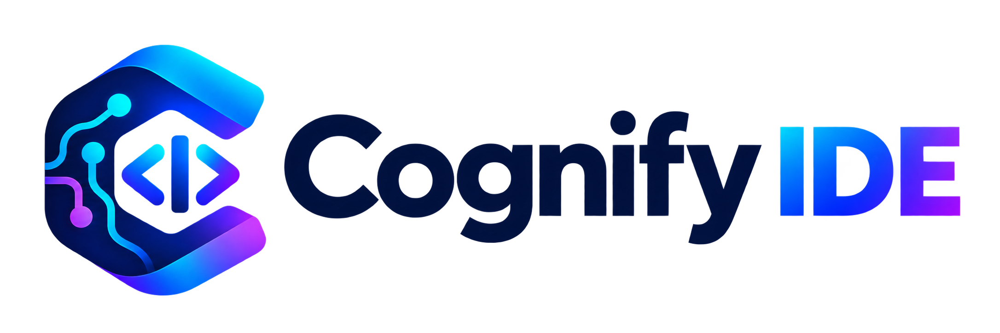

# Cognify IDE

<p align="center">
  <picture>
    <source media="(prefers-color-scheme: dark)" srcset="resources/cognify/brand/cognify-banner-dark.png">
    
  </picture>
</p>

Cognify IDE is an AI-native development environment built on the open-source [`Code - OSS`](https://github.com/microsoft/vscode) project (the MIT-licensed foundation of Visual Studio Code). It adds provider-neutral AI orchestration, role-based agents, and repository-aware reasoning ("Project Cognition") on top of the upstream editor, while keeping the downstream changes small enough to keep merging upstream improvements.

> Cognify IDE is an independent project. It is not affiliated with, sponsored by, or endorsed by Microsoft. "Visual Studio Code" and "VS Code" are trademarks of Microsoft Corporation; Cognify does not use Microsoft product branding.

## Status

Cognify is in early development (Sprint 2: AI provider architecture). Notable changes are listed in [`CHANGELOG.md`](CHANGELOG.md). See [`DevDocs/`](DevDocs/README.md) for the roadmap, sprint plans, and governance documents, and the [issue tracker](https://github.com/devartblake/cognify_ide/issues) for current work.

| Area | Where to look |
|---|---|
| Roadmap | [`DevDocs/Roadmap/REVISED_MVP_ROADMAP.md`](DevDocs/Roadmap/REVISED_MVP_ROADMAP.md) |
| Current sprint | [`DevDocs/Sprints/SPRINT_2_AI_PROVIDER_ARCHITECTURE.md`](DevDocs/Sprints/SPRINT_2_AI_PROVIDER_ARCHITECTURE.md) |
| AI provider routing | [`extensions/cognify-ai/README.md`](extensions/cognify-ai/README.md), contract in [`DevDocs/Architecture/AI_PROVIDER_ROUTING_CONTRACT.md`](DevDocs/Architecture/AI_PROVIDER_ROUTING_CONTRACT.md) |
| Changelog | [`CHANGELOG.md`](CHANGELOG.md) |
| Product identity and branding | [`DevDocs/Governance/PRODUCT_IDENTITY_AND_BRANDING.md`](DevDocs/Governance/PRODUCT_IDENTITY_AND_BRANDING.md), artwork in [`resources/cognify/brand/`](resources/cognify/brand/PROVENANCE.md) |
| Upstream sync policy | [`DevDocs/Governance/UPSTREAM_SYNC_AND_CUSTOMIZATION_POLICY.md`](DevDocs/Governance/UPSTREAM_SYNC_AND_CUSTOMIZATION_POLICY.md) |
| CI and security | [`DevDocs/Quality/CI_AND_SECURITY_BASELINE.md`](DevDocs/Quality/CI_AND_SECURITY_BASELINE.md) |

## Building and Running from Source

Cognify builds the same way as `Code - OSS`. Use the Node.js version in [`.nvmrc`](.nvmrc), then:

```bash
npm install
npm run watch          # incremental build; leave running
./scripts/code.sh      # desktop development build (Windows: .\scripts\code.bat)
./scripts/code-web.sh  # web development build (Windows: .\scripts\code-web.bat)
```

Platform prerequisites (C/C++ toolchain, Python, native-module dependencies) follow the upstream [How to Contribute](https://github.com/microsoft/vscode/wiki/How-to-Contribute#prerequisites) guide. Windows-specific notes are in [`DevDocs/Environment/WINDOWS_BUILD_AND_NATIVE_WATCHDOG.md`](DevDocs/Environment/WINDOWS_BUILD_AND_NATIVE_WATCHDOG.md).

Validation gates used by CI:

```bash
npm run typecheck-client
npm run transpile-client && npm run test-node
node scripts/cognify/check-product-identity.mts
node scripts/cognify/check-upstream-baseline.mts
npx eslint extensions/cognify-ai scripts/cognify
(cd extensions/cognify-ai && npm run typecheck-test && npm test)
xvfb-run -a npm --prefix extensions/cognify-ai run test-integration   # Linux; omit xvfb-run on desktops
```

## Relationship to Code - OSS

- Cognify tracks `microsoft/vscode`. Upstream updates are imported through quarantined sync branches and validated before reaching `dev` (see the upstream sync policy).
- Cognify-specific changes are concentrated in documented customization zones (`product.json`, `DevDocs/`, Cognify workflows and scripts, and Cognify-owned extensions or contribution points) so upstream merges stay tractable.
- Bug reports for Cognify behavior belong in this repository's [issue tracker](https://github.com/devartblake/cognify_ide/issues). Issues that reproduce in unmodified `Code - OSS` should be reported upstream.

## Contributing

Work happens on feature branches that merge into `dev`. Pull requests use the Cognify [pull request template](.github/pull_request_template.md) and must pass the `Cognify (dev)` CI workflow. See [CONTRIBUTING.md](CONTRIBUTING.md) and the upstream [How to Contribute](https://github.com/microsoft/vscode/wiki/How-to-Contribute) guide for coding guidelines.

## Code of Conduct

This project follows the [Microsoft Open Source Code of Conduct](https://opensource.microsoft.com/codeofconduct/) inherited from the upstream repository.

## License

Cognify IDE is distributed under the [MIT](LICENSE.txt) license, the same license as the `Code - OSS` source it is derived from.

Copyright (c) Microsoft Corporation. All rights reserved. Portions copyright (c) Cognify IDE contributors.

Third-party notices are listed in [ThirdPartyNotices.txt](ThirdPartyNotices.txt).
